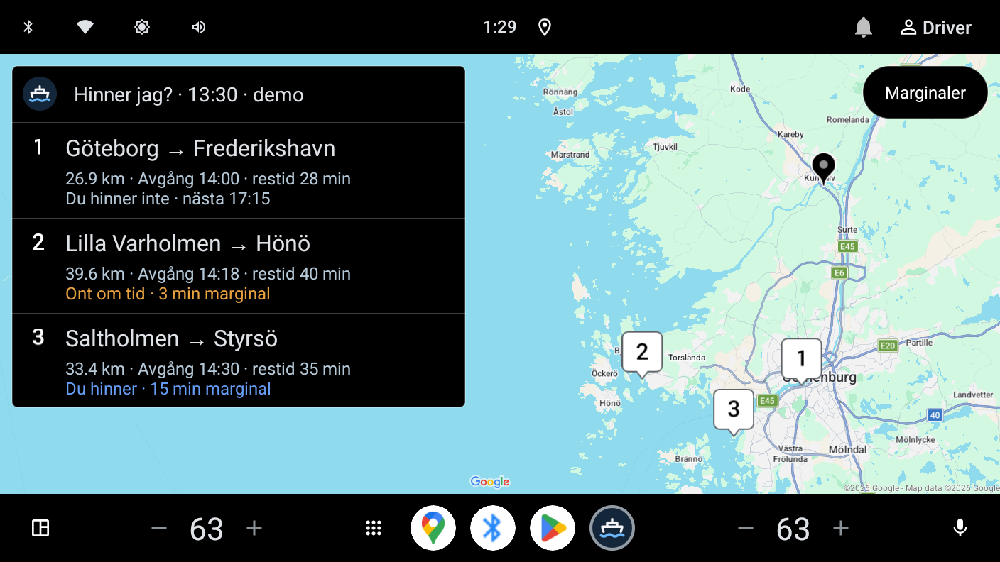
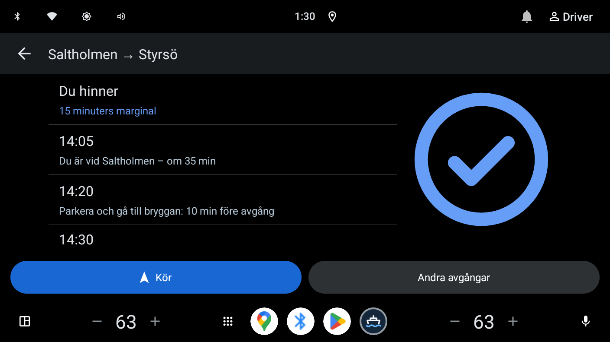
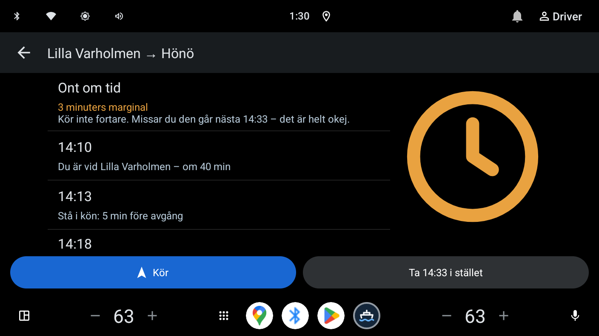
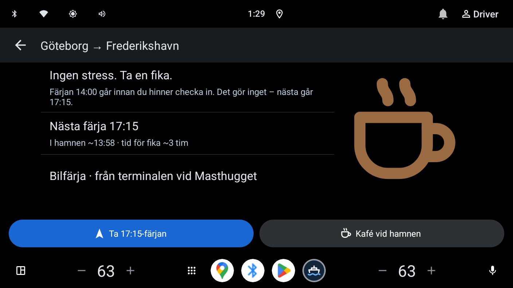
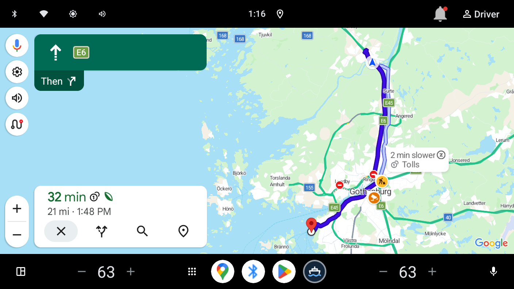
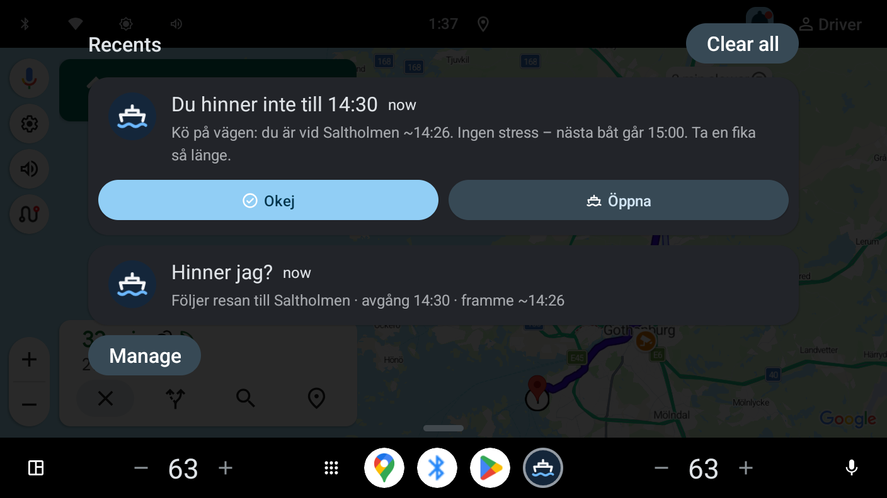
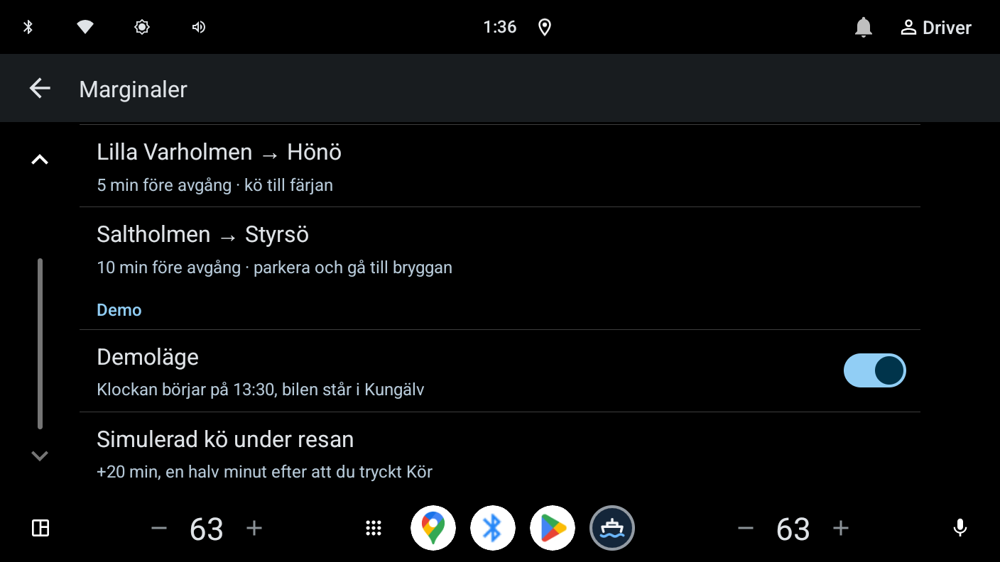

# Hinner jag?

En prototyp för Android Automotive OS som svarar på en enda fråga: hinner jag till färjan?

Välj en färja i närheten så räknar appen ut restiden till hamnen och jämför den med nästa
avgång. Hinner du inte säger appen det lugnt och föreslår en fika, i stället för att du
ska köra fortare.



Appen är byggd med [Car App Library](https://developer.android.com/training/cars/apps) i
kategorin POI (intressepunkter). Bilens system ritar alla skärmar utifrån färdiga mallar,
så appen följer reglerna för vad föraren får se under körning, och samma kod kan i princip
också köras i Android Auto.

## Tre svar

| Du hinner | Ont om tid | Du hinner inte |
| --- | --- | --- |
|  |  |  |
| Minst 5 minuters marginal till sista ombordstigning. | Mindre än 5 minuter. Appen skriver "Kör inte fortare" och visar nästa avgång. | Färjan går innan du är framme. Är det minst 20 minuter till nästa blir det en fika. |

**Marginal** = (avgång − tid för ombordstigning) − ankomst till hamnen. Ankomsten avrundas
alltid uppåt till hel minut, så att en bråkdel av en minut aldrig får "räcka".

## Huvudregeln: aldrig "skynda dig"

Appen säger aldrig "du hinner om du skyndar dig", och det finns inget sådant läge i koden.
Vid ont om tid står det alltid "Kör inte fortare" tillsammans med nästa avgång som en lugn
utväg. Testet `SafetyCopyTest` går igenom alla linjer, varje tid på dygnet och olika
restider, och misslyckas om någon mening uppmanar föraren att öka farten.

En avgång som du inte hinner nämns bara när nästa går om minst 20 minuter. För en färja
som går var 15:e minut, som Hönöleden, visar appen helt enkelt den avgång du faktiskt hinner till.

## Under körningen

**Kör** skickar hamnen som mål till bilens navigationsapp och börjar bevaka resan. Appen
räknar om restiden var 45:e sekund (var 15:e i demoläget) och skickar en avisering bara
när svaret blir sämre: du hinner → ont om tid → du hinner inte.

| Navigeringen tar över | Varningen dyker upp ovanpå navigeringen |
| --- | --- |
|  |  |

Android Automotive visar bara aviseringar ovanpå andra appar (heads-up) för vissa
kategorier: navigering, samtal och meddelanden. Varningen har därför kategorin
*navigation*, eftersom den handlar om körningen. Med en vanlig påminnelse hamnade den
tyst i aviseringscentret.

**Öppna** i aviseringen tar dig direkt till färjans kort. Där kan du välja nästa avgång
(**Ta 15:00-båten**) eller leta upp ett kafé vid hamnen.

## Marginaler

Ombordstigningen tar olika lång tid: incheckning till Danmarksfärjan, kö till vägfärjan,
parkering och promenad till bryggan för skärgårdsbåten. Varje linje har därför en egen
marginal som du ändrar med ett tryck. Här finns också demoläget.



## Demoläge

Demoläget är på från början. Klockan börjar på 13:30 och bilen står i Kungälv. Med riktiga
restider från OSRM ger det tre olika svar:

- **Göteborg → Frederikshavn:** du hinner inte till 14:00, nästa färja går 17:15, tid för fika ~3 tim.
- **Lilla Varholmen → Hönö:** ont om tid till 14:18, 3 minuters marginal.
- **Saltholmen → Styrsö:** du hinner till 14:30, 15 minuters marginal.

Så här ser du aviseringen: välj **Marginaler → Simulerad kö under resan → +20 min**, öppna
**Saltholmen → Styrsö** och tryck **Kör**. En halv minut senare kommer
"Du hinner inte till 14:30".

Stäng av demoläget under **Marginaler** för att använda riktig klocka och bilens position.

## Data och begränsningar

- **Saltholmen → Styrsö kan hämta riktiga tider från Västtrafik.** Appen frågar Västtrafiks
  API *Planera Resa v4* efter direkta båtar från Saltholmen till Styrsös tre bryggor:
  Bratten, Tången och Skäret. Förseningar i realtid räknas med, och inställda turer tas bort. Under en
  resa följer appen en försenad båt i stället för den ursprungliga tiden. Kortet visar
  "Tider från Västtrafik" eller "Påhittade tider", och listan skriver "Västtrafik" eller
  "påhittad".
- **De andra två linjerna har påhittade tider.** Hönöleden körs av Trafikverket och
  Göteborg–Frederikshavn av Stena Line, och ingen av dem finns i Västtrafiks API. Hamnarnas
  koordinater kommer från OpenStreetMap.
- **Restiden kommer från OSRM:s publika demoserver.** Den har ingen trafikinformation och
  en gräns på ungefär en förfrågan per sekund. Det räcker för en prototyp, men en riktig
  app behöver ett rutt-API med trafik i realtid. Om OSRM inte svarar uppskattar appen
  restiden fågelvägen och skriver "(uppskattad)".
- **Navigationsappens ankomsttid går inte att läsa.** Android lämnar inte ut den till andra
  appar, så Hinner jag? räknar fram sin egen restid.
- **Kategorin för varningen är inte prövad i Play-granskning.** Det är inte provat om
  kategorin *navigation* godkänns för en app som själv inte är en navigationsapp.

## Bygga och köra

```bash
export JAVA_HOME="/Applications/Android Studio.app/Contents/jbr/Contents/Home"
./gradlew testDebugUnitTest assembleDebug
adb install -r app/build/outputs/apk/debug/app-debug.apk
adb shell am start -n com.artemkhateev.hinnerjag/androidx.car.app.activity.CarAppActivity
```

### Västtrafik-nyckel

Skapa en applikation på [developer.vasttrafik.se](https://developer.vasttrafik.se), prenumerera
på *Planera Resa v4* och lägg nyckeln i `local.properties` (filen följer inte med i git):

```properties
vasttrafik.clientId=...
vasttrafik.clientSecret=...
```

Utan nyckel, eller om Västtrafik inte svarar, använder appen de påhittade tiderna och visar
det. Nyckeln byggs in i appen, vilket duger för en prototyp men inte för en app i butiken.
Där bör en egen server hämta tiderna.

Testad i emulatorn *Automotive (1408p landscape) with Google Play*, API 35, där systemets
mallvärd (templates host) och Google Maps redan finns. Inställningen
`heads_up_notifications_enabled` spelar ingen roll där: varningen dyker upp oavsett om
den är 0 eller 1.

## Kodstruktur

```
model/      Ferry.kt (tidtabell), Verdicts.kt (regeln), Copy.kt (alla svenska meningar)
timetable/  Västtrafik Planera Resa v4, reserv med påhittade tider, cache i 2 min
eta/        OSRM, uppskattning fågelvägen, cache i 60 s
car/     CarAppService och Session, listan, färjans kort, Marginaler
trip/    bevakning av resan, aviseringar, förgrundstjänst (typ location)
```

## Inte gjort än

- Riktiga tider för Hönöleden (Trafikverkets API) och Stena Line, och trafik i realtid.
- Android Auto. Det kräver en modul med `app-projected`, men skärmarna kan delas.
- Karta på färjans kort (`MapWithContentTemplate`, Car App API-nivå 7).
- Kaféknappen förutsätter att navigationsappen förstår en sökning (`geo:0,0?q=`).

## Licens

MIT, se [LICENSE](LICENSE).
